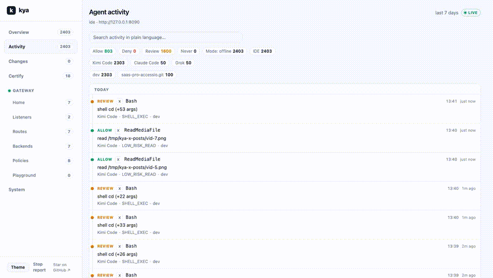
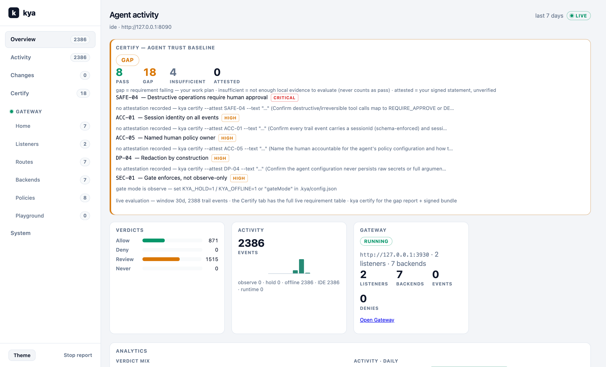
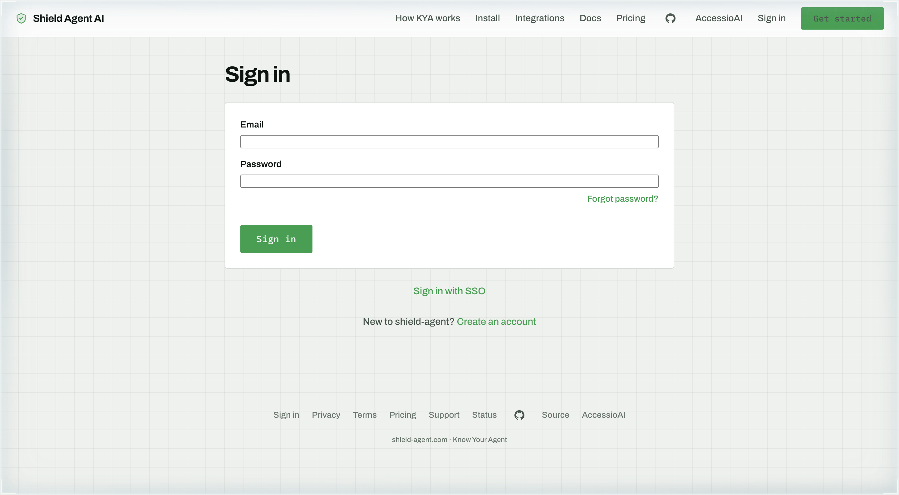
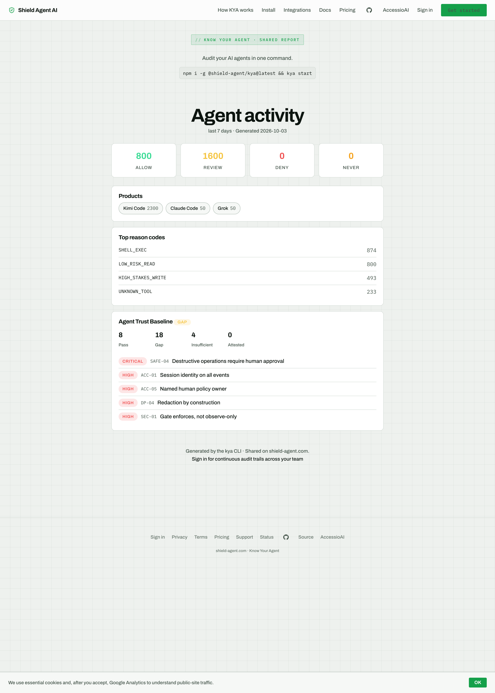
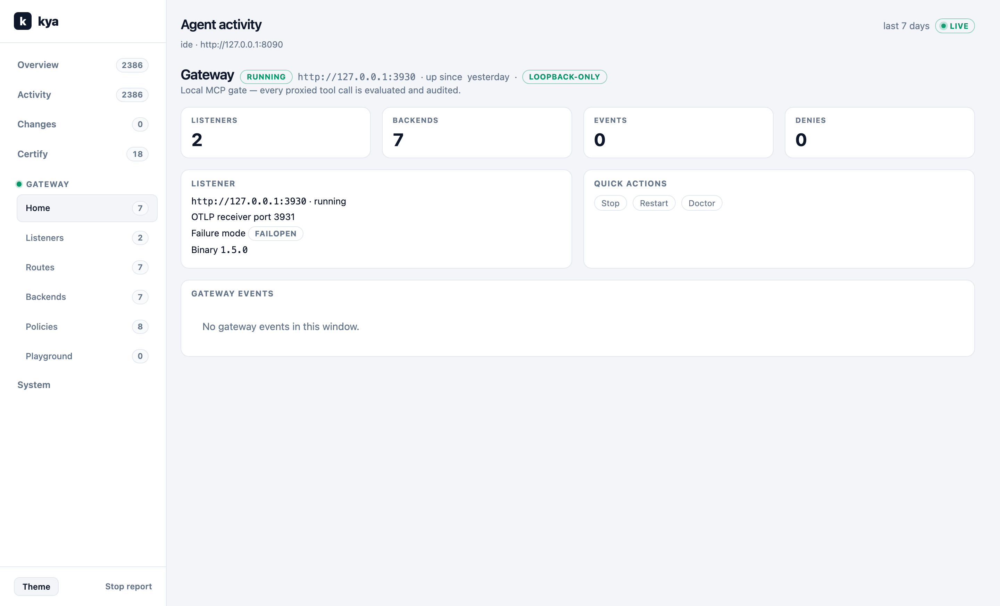

# KYA Certify GitHub Action

AI agent audit trail and trust baseline, in your CI.

[](https://github.com/marketplace/actions/kya-certify)
[](LICENSE)
[](https://www.npmjs.com/package/@shield-agent/kya)



`kya certify` checks your repo's local agent-activity evidence against the KYA Agent Trust Baseline and reports gaps. This action runs it in CI on any repository that uses AI coding agents. Each run writes a job summary, posts the gap summary as a PR comment, and sets the step result from the `fail-on` input.

The check is advisory. It reports missing evidence. It does not block agent actions.

<!-- adoption:start -->
Adoption, measured. The badge reads a public file that a daily job writes. A count under 50 is not shown. The badge reads "unavailable" when the last measurement failed. The website also hides any figure older than 48 hours.

[](https://raw.githubusercontent.com/The-Pixel-Boys/shield-kya/downloads-data/badge-action-repos.json)

Repos using kya-action: public repos outside The-Pixel-Boys, counted by GitHub code search. This count is approximate. Private repos are not counted, and the search covers default branches only.

Hosted channel counts (Slack, Teams, webhook, helpdesk) and the date of each count are on https://shield-agent.com.
<!-- adoption:end -->

## Quickstart

```yaml
name: KYA Certify
on:
  pull_request:
  push:
    branches: [main]

permissions:
  contents: read
  pull-requests: write

jobs:
  certify:
    runs-on: ubuntu-latest
    steps:
      - uses: actions/checkout@v4

      - uses: The-Pixel-Boys/kya-action@v1  # pin to a full commit SHA in production, see "Pinning"
        with:
          fail-on: gap        # gap | never
          window-days: 30     # look-back window for agent-activity evidence
          comment-on-pr: true
          footer: true        # false hides the hosted history link in the job summary
```

## What you get

**Job summary.** Each run writes a Markdown summary to the job summary page of the run. It shows:

- A verdict line.
- Counts of passed requirements, gaps, and requirements with insufficient evidence.
- The top 5 gaps, most severe first, each with its evidence hint.
- A footer line that links to hosted history (turn it off with `footer: false`). The link has no tracking parameters.

Example (from a real run, shortened):

```markdown
## KYA Certify: Agent Trust Baseline

**Verdict:** failed. 19 gap(s) found, and fail-on is gap, so this step fails.

| Result | Count |
|---|---|
| Passed | 7 |
| Gap | 19 |
| Insufficient evidence | 5 |

Window: 30 days, fail-on: gap, exit code 1, 2747 trail events

**Top gaps**

- `SAFE-04` (critical) **Destructive actions need human approval**: no statement recorded ...
- `DP-04` (high) **Secrets are never written to disk**: no statement recorded ...

Hosted history: https://shield-agent.com/
```

The verdict line uses one of these values:

| Verdict | When | Step result |
|---|---|---|
| `passed` | certify exit 0 | success |
| `failed` (gaps) | gaps found, `fail-on: gap` | fails |
| `gaps found` | gaps found, `fail-on: never` | success |
| `failed` (error) | certify ended in an error, `fail-on: gap` | fails |
| `error` | certify ended in an error, `fail-on: never` | success |
| `failed` (did not run) | an earlier step (install) failed | fails |

**PR comment.** On pull requests the action also posts the status pill, the counts, and the top gaps as a comment. The comment is updated on each run.

**Report files.** Reports (JSON, MD, HTML) are written to `.kya/certify/`. Upload them as workflow artifacts. When `fail-on: never`, the step never fails the job, also when the status is `error`. The exit code is still exposed in the outputs, the job summary, and the PR comment.

To upload the reports, give the action step an `id` and upload only when the status is `pass` or `gap` (not on `error`, and not when the status is empty because an earlier step failed), so a symlink planted under `.kya` in a PR is never followed into the artifact:

```yaml
      - uses: The-Pixel-Boys/kya-action@v1
        id: kya
      - uses: actions/upload-artifact@v4
        if: ${{ always() && (steps.kya.outputs.status == 'pass' || steps.kya.outputs.status == 'gap') }}
        with:
          name: kya-certify-report
          path: .kya/certify/
```

## Recipes

The check reads agent-activity evidence from `.kya/` in the checkout. A CI run only sees what the repo holds. Until the evidence is in place, use `fail-on: never` so the job reports gaps without failing.

### Plain workflow

Use the Quickstart above. It works for any pull request, including pull requests opened by an agent.

### Claude Code Action

Runs Claude Code on each pull request, then runs the KYA check in the same job. Set the `ANTHROPIC_API_KEY` secret in your repository. For the permissions each mode needs, see the Claude Code Action security docs.

```yaml
name: Claude Code review with KYA Certify
on:
  pull_request:

permissions:
  contents: read
  pull-requests: write

jobs:
  review:
    runs-on: ubuntu-latest
    steps:
      - uses: actions/checkout@v4
        with:
          persist-credentials: false

      - name: Review with Claude Code
        uses: anthropics/claude-code-action@d70510b174a1244958df0b03166a54912811f3e6 # v1.0.264
        with:
          anthropic_api_key: ${{ secrets.ANTHROPIC_API_KEY }}
          prompt: "Review this pull request. List the three biggest risks in short bullet points."

      - name: KYA Certify
        uses: The-Pixel-Boys/kya-action@v1  # pin to a full commit SHA in production
        with:
          fail-on: never
          comment-on-pr: true
```

### Codex

Runs Codex in read-only mode on each pull request, then runs the KYA check. Set the `OPENAI_API_KEY` secret in your repository.

```yaml
name: Codex review with KYA Certify
on:
  pull_request:

permissions:
  contents: read
  pull-requests: write

jobs:
  codex:
    runs-on: ubuntu-latest
    steps:
      - uses: actions/checkout@v4
        with:
          persist-credentials: false

      - name: Review with Codex
        uses: openai/codex-action@bdf19a4a223ec2549a3e2274a0cf61556bc07675 # v1.13
        with:
          openai-api-key: ${{ secrets.OPENAI_API_KEY }}
          permission-profile: ":read-only"
          prompt: "Review this pull request. List the three biggest risks in short bullet points."

      - name: KYA Certify
        uses: The-Pixel-Boys/kya-action@v1  # pin to a full commit SHA in production
        with:
          fail-on: never
          comment-on-pr: true
```

### Copilot coding agent

The Copilot coding agent opens pull requests like any other contributor. The quickstart workflow checks those pull requests, so the agent needs no change. Check that your repository runs workflows on pull requests that the agent opens.

```yaml
name: KYA Certify
on:
  pull_request:

permissions:
  contents: read
  pull-requests: write

jobs:
  certify:
    runs-on: ubuntu-latest
    steps:
      - uses: actions/checkout@v4
        with:
          persist-credentials: false

      - uses: The-Pixel-Boys/kya-action@v1  # pin to a full commit SHA in production
        with:
          fail-on: never
          comment-on-pr: true
```

## Inputs

| Input | Default | Description |
|---|---|---|
| `fail-on` | `gap` | When the workflow fails: `gap` (any gap) or `never` (report only). Maps to `kya certify --fail-on`, which accepts exactly these two values; anything else exits 2 and the step reports `status=error`. |
| `window-days` | `30` | Look-back window in days for agent-activity evidence. Maps to `kya certify --window`. |
| `comment-on-pr` | `true` | Post the gap summary as a PR comment (status pill, pass/gap counts, top gaps). |
| `kya-version` | `latest` | Version, dist-tag or range of `@shield-agent/kya` to install (for example `0.29.0`, `latest`, `^0.29`). Only versions, dist-tags and ranges are accepted; npm aliases, git, URL, directory (`.`, `..`) and tarball specs are refused. The package is installed with `--ignore-scripts`. |
| `footer` | `true` | Add a footer line with a link to hosted history to the job summary. Set `false` to turn it off. |

## Outputs

| Output | Description |
|---|---|
| `exit-code` | Exit code of `kya certify` (0 = clean, 1 = gaps, 2+ = error). `1` with `status=error` means the CLI refused a write (`PROJECT_PATH_REFUSED`) or the report path was unsafe after the run. Empty when certify was not run because the report path is unsafe. |
| `status` | Certify outcome: `pass` (exit 0), `gap` (exit 1), or `error` (any other exit code, a `PROJECT_PATH_REFUSED` refusal, or a symlinked or out-of-workspace report path). |

## Pinning and releases

- Pin this action to a full commit SHA in production workflows. Find the SHA of a release tag with `gh api repos/The-Pixel-Boys/kya-action/commits/<tag> --jq .sha`, then use `The-Pixel-Boys/kya-action@<sha> # <tag>`.
- The action pins its own third-party steps to full commit SHAs.
- Releases are immutable. The release and tag policy is in [docs/RELEASING.md](docs/RELEASING.md).

## Symlinks in the checkout

A pull request can commit symlinks. If `.kya`, `.kya/certify` or `.kya/certify/report.json` is a symlink or resolves outside the workspace, or anything under `.kya` is a symlink, the action does not run `kya certify` (or, if the link shows up during the run, does not read the report), reports `status=error` and posts no report contents in the PR comment. kya releases after 0.29.0 also refuse such writes themselves: they exit 1 and print `PROJECT_PATH_REFUSED`. The action reports that as `status=error` too, never as `gap`, so `exit-code=1` together with `status=error` means a refusal. With `fail-on: never` the step does not fail the job on `status=error` either, so check the `status` output if you need to act on it. To fix it, replace the link with a regular directory or file and re-run.

Inputs are passed to the shell and to the comment script through environment variables, never by interpolating them into the script, so an input value cannot inject shell or JavaScript code. `kya-version` is also limited to an npm version, dist-tag or range and is installed from outside the checkout with `--ignore-scripts`, so it cannot point npm at files in the PR. Still prefer fixed values over PR data for the inputs.

## Requirements

The action installs Node.js 24 with `actions/setup-node` and then `@shield-agent/kya` from npm (`npm i -g --ignore-scripts`, run outside the checkout). The CLI itself needs Node.js 22 or newer.

Beyond the CI report, the KYA toolkit gives you:

**OSS receipt report**



**Hosted dashboard**



**Shared report page**



**Gateway**



## Links

- OSS repo: https://github.com/The-Pixel-Boys/shield-agent
- npm: https://www.npmjs.com/package/@shield-agent/kya
- Hosted: https://shield-agent.com

## License

MIT. See [LICENSE](LICENSE).
